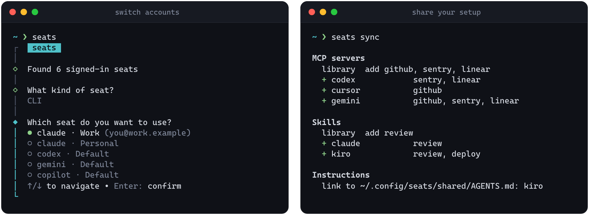

<div align="center">
  <h1>Seats</h1>
  <p><strong>One terminal, every AI account.</strong></p>
  <p>Switch between Claude, Codex, Gemini, Copilot and more without logging out.<br />Your MCP servers, skills, instructions and folder trust follow you to every seat and every tool.</p>
  <p>
    <a href="LICENSE"></a>
    
  </p>
  <p>
    <a href="#install">Install</a> ·
    <a href="#usage">Usage</a> ·
    <a href="#one-folder-for-every-seat">Seat folders</a> ·
    <a href="#shared-config-between-seats">Shared config</a> ·
    <a href="#one-setup-across-tools">Across tools</a> ·
    <a href="#supported-providers">Providers</a> ·
    <a href="#how-it-works">How it works</a>
  </p>
</div>

<p align="center">
  
</p>

## Why

Hitting a usage limit mid-task shouldn't mean logging out, logging back in and re-approving every folder. With seats, each account lives in its own folder and switching is one pick. The account changes; your setup stays the same.

- **Switch in one step.** Pick a seat and seats repoints `~/.claude`, `~/.codex` and the rest, then launches the CLI on that account.
- **Bring your setup along.** Seats of the same tool share their config: settings, skills, agents, hooks, plugins, MCP servers and instructions. Only the login stays per account.
- **Trust folders once.** Trusting a folder or approving a tool in one seat carries over to the others. You won't see the trust prompt again for that folder.
- **One setup across tools.** An MCP server added in Cursor shows up in Claude Code, Codex, Gemini, Copilot, Kiro, OpenCode and Antigravity, each in its own format. Skills and global instructions follow too.
- **Keep your home tidy.** All seats live under `~/.config/seats` instead of a pile of `~/.claude-*` folders.
- **Switch API keys and cloud profiles too.** OpenRouter, OpenAI, AWS, Google Cloud and Azure seats write env vars to a single file for your shell to source.

## Install

```bash
curl -fsSL https://raw.githubusercontent.com/gelzinn/seats/main/install.sh | bash
```

This works once the first release is published. The script downloads the binary for your machine (Linux or macOS, x64 or arm64), checks it against the release's `SHA256SUMS` and installs it to `~/.local/bin/seats`. Bun isn't needed. Run it again to update.

To pin a release or install somewhere else, set `SEATS_VERSION` or `SEATS_INSTALL_DIR`:

```bash
curl -fsSL https://raw.githubusercontent.com/gelzinn/seats/main/install.sh | SEATS_VERSION=0.1.0 bash
```

<details>
<summary>From source</summary>

Requires [Bun](https://bun.sh).

```bash
git clone https://github.com/gelzinn/seats.git
cd seats
bun install
bun start
```

To get a `seats` command, add an alias to your shell config:

```bash
alias seats="bun /path/to/seats/src/cli.ts"
```

</details>

## Usage

```bash
seats                    # pick a kind, then a seat, then launch it
seats list               # every signed-in seat
seats list api           # only cli | api | cloud
seats list claude        # one tool (or provider, or a seat id); signed-out seats show dimmed
seats current            # what each live path points at
seats use claude:work    # activate without launching
seats run claude         # launch the active seat, no picker (works as alias claude='seats run claude')
seats auto-switch on     # off by default: move to the next seat when one hits its limit
seats use api:openrouter
seats health             # ask every seat to reply and see which ones work
seats add claude work    # sign a new account in, without touching the active one
seats sync --dry-run     # preview what sync would share, add or link
seats sync               # share config between seats and across tools
seats install mcp docs -- npx -y docs-mcp   # add an MCP server to every tool
seats uninstall mcp docs                    # and take it out of every tool
seats export ~/dotfiles/seats   # your shared setup, without secrets, to carry to another machine
seats import ~/dotfiles/seats   # and add it on the new machine
seats migrate --dry-run  # preview moving ~/.<tool>-* into ~/.config/seats
seats migrate
seats --version          # the installed version
```

Extra arguments after the picker go straight to the CLI, so `seats --resume` opens the chosen seat with `claude --resume`.

API and cloud seats write env vars to `~/.config/seats/active.env` (mode `600`). Source it in your shell:

```bash
source ~/.config/seats/active.env
```

## Check your seats

`seats health` asks every signed-in Claude Code and Codex seat to reply with "ok", all at once, and shows what came back:

```text
┌─────────────────┬──────────────────────┬─────────┬──────────────────────────────────────────────────────┬───────────────────┐
│ Seat            │ Account              │ Plan    │ Reply                                                │ Time              │
├─────────────────┼──────────────────────┼─────────┼──────────────────────────────────────────────────────┼───────────────────┤
│ claude:work     │ you@work.example     │ Max 20x │ ok                                                   │ 2.3s · haiku      │
│ claude:personal │ you@personal.example │ Pro     │ ok                                                   │ 2.1s · haiku      │
│ codex:work      │ you@work.example     │ Plus    │ You have hit your usage limit. Try again at 6:00 PM. │ 1.4s · gpt-6-luna │
└─────────────────┴──────────────────────┴─────────┴──────────────────────────────────────────────────────┴───────────────────┘
```

It catches what switching wouldn't tell you: a seat that was signed out, hit its usage limit or points at a model the account can't use. The Plan column comes from what each tool already knows about the account (Claude's subscription and rate-limit tier, ChatGPT's plan for Codex). Each check is one tiny prompt on the cheapest model, whatever your config says: Haiku for Claude, and for Codex the newest small model in that account's model list, at its lowest reasoning effort. The Time column shows which model answered. It runs from a temporary folder so no project context is sent. Pass a tool or seat id to check fewer: `seats health codex`, `seats health claude:work`. The command exits with status 1 when any seat doesn't answer, so it works in scripts.

## Switch accounts at the limit

Off by default. Turn it on with `seats auto-switch on`. Tools you launch through seats (`seats`, or `seats run <tool>`) then keep going when an account runs out:

- **Before launching,** seats checks the seat's usage and, if it's at a limit, picks the next seat of the same tool that isn't. This works for Claude Code and Codex, and costs nothing: it reads the same usage endpoints their apps show.
- **Mid-session (Claude Code),** when a turn fails on the usage limit, seats closes that session, copies the conversation to the next seat and reopens it there with `claude --resume`. It then sends "Continue where you left off." so the work goes on by itself. Use `seats auto-switch on --no-continue` to resume without sending anything.
- When every seat is out, seats stops and tells you when the first one resets.

How it stays out of the way:

- The limit is reported by a Claude Code `StopFailure` hook that seats passes with `--settings` to the sessions it launches. Your `settings.json` is never changed, and sessions you start without seats never see it. A passing `429` doesn't trigger a switch: seats confirms on the usage endpoint that the seat is really at 100%.
- Your active seat (`~/.claude` and friends) doesn't change. Only the supervised session moves, so other sessions and tools keep the account they had.
- Codex has no hook for this, so it gets the check before launching only.
- To get it every time you type `claude`, add `alias claude='seats run claude'` to your shell config. `seats run` also works with auto-switch off, as a way to launch the active seat without the picker.

```bash
seats auto-switch on      # or: on --no-continue
seats auto-switch status
seats auto-switch off
```

## One folder for every seat

```text
~/.config/seats/
├── active.env          API / cloud env vars (600)
├── claude/
│   ├── personal/       one config dir per account
│   └── work/
├── codex/
│   └── work/
└── shared/
    ├── claude/         settings, skills, agents, plugins… linked into every Claude seat
    ├── codex/          config.toml, AGENTS.md, skills… for Codex seats
    ├── mcp.json        every MCP server, in one tool-neutral list
    └── AGENTS.md       global instructions, linked as CLAUDE.md, AGENTS.md, GEMINI.md…
```

The live paths in `$HOME` (`~/.claude`, `~/.claude.json`, `~/.codex`, …) stay where the CLIs expect them. They become symlinks to the active seat.

**Add an account** from seats, without signing out of the one you're using:

```bash
seats add                          # pick the tool, then name the seat
seats add claude work              # or say both up front
seats add codex personal -- --device-auth   # extra args go to the tool's login
```

seats creates `~/.config/seats/<tool>/<name>` and runs the tool's own sign-in there. You get the link, open it in any browser, and paste the code back into the terminal when asked. If sign-in doesn't finish, the folder is removed. Naming a seat that already exists but is signed out signs it in again in place, keeping its files; a seat that's still signed in is left alone. Once you're in, the new seat picks up the settings, skills and MCP servers your other seats share, and seats offers to switch to it.

`seats add` works with Claude Code and Codex, which keep each login inside its own folder. Copilot stores its token in the system keyring, Gemini CLI signs in on first run and Kiro doesn't document where its login lives, so sign in to those with the tool itself.

**Already have `~/.claude-work`-style folders?** They are still discovered. To move them into the store:

```bash
seats migrate --dry-run   # shows every move
seats migrate
```

Close running agent sessions first, because a session keeps writing to its old folder. `migrate` moves each folder, repoints the live symlinks and any links between seats, and rewrites paths in `settings.json`. It skips backup and stub folders, refuses to overwrite an existing seat, and stops if a move would cross filesystems. Afterwards, update any `CLAUDE_CONFIG_DIR` you set in your shell config.

If a live path such as `~/.claude` is still a real directory, seats won't replace it. Move it into the store first.

## Shared config between seats

When a tool has two or more seats, activating one of them, or running `seats sync`, makes all of that tool's seats share their config. A tool with a single seat is left alone.

| Tool | Shared between seats | Stays per account |
| --- | --- | --- |
| **Claude** | See the table below | `.credentials.json`, sessions, history |
| **Codex** | `config.toml` (MCP servers and trusted projects), `AGENTS.md`, `agents/`, `skills/`, `rules/`, `prompts/`, `hooks.json` | `auth.json`, sessions, history |
| **Gemini** | `settings.json`, `GEMINI.md`, `trustedFolders.json`, `skills/`, `commands/`, `extensions/` | `oauth_creds.json`, `google_accounts.json` |
| **Copilot** | `settings.json`, `mcp-config.json`, `copilot-instructions.md`, `instructions/`, `agents/`, `skills/`, `hooks/` | `config.json`, MCP OAuth and secrets |
| **Kiro** | `settings/mcp.json`, `settings/cli.json`, `steering/`, `agents/`, `skills/` | Sign-in and sessions |
| **Command Code** | `settings.json`, `skills/` | `auth.json` |

<details>
<summary><strong>Claude: what is shared and what stays per account</strong></summary>

| Shared across seats | Stays per account |
| --- | --- |
| `settings.json`, `CLAUDE.md`, `keybindings.json`, `statusline-command.sh` | Login (`.credentials.json`) and `oauthAccount` |
| `agents/`, `commands/`, `skills/`, `hooks/`, `output-styles/`, `themes/` | Sessions, history and transcripts |
| Installed plugins, marketplaces and plugin cache | Org-synced plugins (`plugins/synced`) and policy limits |
| User MCP servers (`mcpServers` in `.claude.json`) | MCP OAuth tokens, so each account authenticates once |
| Folder trust, approved tools and approved `.mcp.json` servers | Usage stats and onboarding state |

</details>

<details>
<summary><strong>How merging works</strong></summary>

- **Files and folders** move into `~/.config/seats/shared/<tool>` and each seat gets a symlink. The newest copy wins. Folders are merged entry by entry, and JSON files keep keys that only an older copy had. Anything that can't be merged is kept as `*.seats-backup`, never deleted.
- **Symlinks you made yourself** that point outside the seat folders, for example into a dotfiles repo, are left untouched.
- **`.claude.json`** is merged in place. Trust and approvals are only ever added, never revoked. An MCP server already defined in a seat is never overwritten. Everything else in the file is left alone. Writes go through the `~/.claude.json` symlink and keep mode `600`. A seat whose file doesn't parse is skipped.

</details>

## One setup across tools

`seats sync` also keeps MCP servers, skills and global instructions the same in every tool you have installed. Run `seats sync --dry-run` first to see every change it would make. It doesn't run when you switch seats.

| Tool | MCP servers | Skills | Instructions |
| --- | --- | --- | --- |
| **Claude Code** | `~/.claude.json` | links in `~/.claude/skills` | `~/.claude/CLAUDE.md` |
| **Codex** | `~/.codex/config.toml` | reads `~/.agents/skills` | `~/.codex/AGENTS.md` |
| **Cursor** | `~/.cursor/mcp.json` | reads `~/.agents/skills` | set in Cursor's UI |
| **Gemini CLI** | `~/.gemini/settings.json` | reads `~/.agents/skills` | `~/.gemini/GEMINI.md` |
| **Copilot CLI** | `~/.copilot/mcp-config.json` | reads `~/.agents/skills` | `~/.copilot/copilot-instructions.md` |
| **Kiro** | `~/.kiro/settings/mcp.json` | links in `~/.kiro/skills` | `~/.kiro/steering/AGENTS.md` |
| **OpenCode** | `~/.config/opencode/opencode.json` | reads `~/.agents/skills` | `~/.config/opencode/AGENTS.md` |
| **Antigravity** | `~/.gemini/config/mcp_config.json` | links in `~/.gemini/config/skills` and `antigravity-cli/skills` | `~/.gemini/GEMINI.md` |

Only tools that are installed are touched. `CODEX_HOME`, `COPILOT_HOME`, `GEMINI_CLI_HOME` and `KIRO_HOME` are respected.

<details>
<summary><strong>MCP servers</strong></summary>

- Servers from every tool are collected into `~/.config/seats/shared/mcp.json`, then each tool gets the ones it's missing, written in its own format: `command`/`args`/`env` or `url`/`headers`, Codex TOML tables, OpenCode `local`/`remote` entries, Gemini `httpUrl`, Antigravity `serverUrl`, Copilot `tools`.
- Nothing a tool already has is changed. Names are compared ignoring case, and a name a tool already uses is never written again, even if seats can't read that entry.
- Codex doesn't run SSE servers, so they're skipped there. Codex's own `node_repl` stays in Codex.
- To keep a server out of one tool, add `"skip": ["cursor"]` to it in `mcp.json`. To remove it everywhere, run `seats uninstall mcp <name>`: it deletes the server from your tools and sets `"skip": ["*"]` so it isn't imported again.
- Sync warns when a server's credentials may not work in a tool it was copied to. That happens with env var references, because each tool spells them differently (`${VAR}`, `${env:VAR}`, `{env:VAR}`), and with Codex's `bearer_token_env_var`. OAuth logins are per tool, so each tool asks once.

</details>

<details>
<summary><strong>Skills</strong></summary>

- `~/.agents/skills` is the library. Codex, Cursor, Gemini CLI, Copilot CLI and OpenCode read it directly.
- A skill that lives only in one tool's folder moves into the library. Tools that read their own folder keep a link to it.
- Claude Code, Kiro, Antigravity and Command Code get a link for every skill another tool already uses. Library skills that no tool uses stay unlinked, so the skills you installed for specific tools don't flood the others.
- A skill with the same name but different content is reported and left alone.

</details>

<details>
<summary><strong>Instructions</strong></summary>

- `~/.config/seats/shared/AGENTS.md` is seeded from your first non-empty instructions file. Every tool's file becomes a link to it.
- Empty files, and files with the same text (ignoring HTML comments), are linked. A file with different text is reported and left alone, so nothing you wrote is lost.

</details>

### Install an MCP server or skill everywhere

`seats sync` spreads what your tools already have. To add something new to every installed tool in one step, use `seats install`:

```bash
seats install mcp docs -- npx -y docs-mcp
seats install mcp docs -- npx -y docs-mcp --env TOKEN=your-token
seats install mcp github --url https://api.example.com/mcp --header "Authorization: Bearer your-token"
seats install mcp stream --url https://stream.example.com/sse --sse
seats install mcp docs --set codex.startup_timeout_sec=30 -- npx -y docs-mcp
seats install skill ./review
seats install skill https://github.com/you/review-skill.git
seats install skill https://github.com/you/tools.git --skill review
seats uninstall mcp docs
seats uninstall skill review
```

- **MCP servers** go into `~/.config/seats/shared/mcp.json`, then into every installed tool in its own format. Everything after `--` is the server's command, passed on unchanged, except seats' own `--env KEY=VALUE`, `--force` and `--dry-run` at the very end. They can also go before `--`. A tool that can't run the server is skipped, and the report says why. For example, Codex doesn't run SSE servers.
- **Options for one tool** go in with `--set <tool>.<key>=<value>`, repeatable. The field is written only into that tool's entry, in its format, and overrides seats' own field with the same name. For example, `--set codex.startup_timeout_sec=30` gives a slow-starting server more time in Codex, and `--set copilot.tools='["search"]'` limits the tools Copilot exposes. Numbers, `true`/`false` and JSON string arrays keep their type. The options are saved with the server in `mcp.json`, so `--force` and `seats sync` write them again.
- **A name that's already taken** is left alone. If a tool already has a server with that name (ignoring case), its entry is kept and reported as "already there". `--force` replaces it in every tool, every Claude seat included, and in the library. Without `--force`, a different server with that name in the library stops the install before anything is written.
- **Skills** are copied into `~/.agents/skills/<name>`. The folder or repo you give can be the skill itself, or keep it anywhere inside, like `skills/<name>` or `.agents/skills/<name>`. When it holds several, seats lists them and `--skill <name>` picks one. Git URLs are cloned with `--depth 1`. The name comes from `name:` in the SKILL.md front matter, or else from the folder name, which for a git URL is the repository name.
- **Links to the skill** go into Claude Code, Kiro, Antigravity and Command Code. The other tools read the library themselves, so they get no link. `--force` replaces a copy already in the library, and a tool's link with that name that points somewhere else. A tool's own folder with that name is never touched.
- **`seats uninstall mcp`** removes the server from every tool and every Claude seat. It then marks the server `"skip": ["*"]` in `mcp.json`, so `seats sync` doesn't import it again. Installing the server again clears the mark.
- **`seats uninstall skill`** removes the links that point at the library copy, then the copy itself. A tool's own folders and links that point elsewhere are kept.
- Add **`--dry-run`** to any of these commands to see the plan without changing anything.

## Move your setup to another machine

`seats export` writes what seats shares to a folder: `mcp.json`, `AGENTS.md`, each tool's shared config and the skills in `~/.agents/skills`. `seats import` adds it on the other machine.

```bash
seats export ~/dotfiles/seats --dry-run   # see what would be written
seats export ~/dotfiles/seats
seats import ~/dotfiles/seats             # on the new machine
```

The folder holds no accounts and no secrets, so it can live in a dotfiles repo.

- **Never exported:** seat folders, logins, sessions and history, `active.env`, `*.seats-backup` files, and things that only hold on this machine. These are Claude's plugin cache and marketplace clones (Claude Code fetches them again from the two plugin lists, which are exported), Gemini's `trustedFolders.json` and Codex's trusted projects.
- **Secrets become references.** Literal values under `env` and `headers` become `${NAME}`: the env key, or the server and header name for headers (`DOCS_AUTHORIZATION`). Values that are already references, and file paths, stay as they are. In Codex's `config.toml`, `bearer_token` becomes `bearer_token_env_var` and a literal header moves to `env_http_headers`, which Codex reads from the environment. `env` values get `${NAME}` placeholders to fill in. Claude's `settings.json` doesn't expand references in its `env`, so literal values there are left out.
- **A leak check runs last.** Seats searches the written folder for every secret it took out, and if one is still there (in a server's `args`, say), it deletes the export and stops. Values shorter than 8 characters aren't searched for, since they appear everywhere by chance.
- **Paths to your home folder** in JSON and TOML files are written as `~` and expanded to the new home on import.
- **The folder** must be empty or hold an earlier export, which is replaced. Other files in it, like a `.git`, are kept.
- **`seats-export.json`** records the seats version, the date, every file, what was left out, and the env vars to define on the new machine. It holds names, never values.

Import never replaces your files:

- Files you don't have are added. JSON files are merged, and your copy wins every conflict. An MCP server you already have, by name ignoring case, is kept as it is.
- Another file that differs is kept, and the export's copy is saved next to it as `<name>.seats-import`. A skill you have with different content is kept and reported.
- Then it runs `seats sync`, so the MCP servers, skills and instructions reach every installed tool. A tool's shared config reaches its seats once it has two or more.
- Last, it lists the env vars the imported config uses that aren't set in your shell.

## Use seats from other tools

Tools that launch a CLI on a given seat can ask seats for its folder instead of hardcoding a path, so `seats migrate` doesn't break them:

```ts
import { seatDir, seatEnv } from "seats";

seatDir("claude", "work"); // "/home/you/.config/seats/claude/work"
seatEnv("claude", "work"); // { CLAUDE_CONFIG_DIR: "/home/you/.config/seats/claude/work" }
```

`listSeatDirs(provider)` lists every seat folder, signed in or not. The library only reads folders and never runs a CLI.

**Paseo.** [`integrations/paseo`](integrations/paseo) is a Paseo plugin that sets `CLAUDE_CONFIG_DIR` from seats whenever a `claude-<seat>` provider opens a session. Keep the provider's `env` in Paseo's `config.json` too, because provider diagnostics and model listing don't go through the plugin. Paseo only loads modules from inside the plugin folder, so the plugin installs seats as a copy (`install-links`). After changing the library, run `bun run build` here and `npm install` in `integrations/paseo`, then reload the plugin.

## Supported providers

### CLI

| Provider | Seat folders | Live path |
| --- | --- | --- |
| **Claude** | `~/.config/seats/claude/*`, legacy `~/.claude-*` | `~/.claude`, `~/.claude.json` |
| **Codex** | `~/.config/seats/codex/*`, `~/.codex`, `~/.codex-*` | `~/.codex` |
| **Gemini** | `~/.config/seats/gemini/*`, `~/.gemini`, `~/.gemini-*` | `~/.gemini` |
| **Copilot** | `~/.config/seats/copilot/*`, `~/.copilot`, `~/.copilot-*` | `~/.copilot` |
| **Kiro** | `~/.config/seats/kiro/*`, `~/.kiro`, `~/.kiro-*` | `~/.kiro` |
| **Command Code** | `~/.config/seats/commandcode/*`, `~/.commandcode`, `~/.commandcode-*` | `~/.commandcode` |
| **Antigravity** | `~/.antigravity` | `~/.antigravity` |
| **OpenCode** | `~/.local/share/opencode` | — |

A seat only appears once it is signed in. For Claude, seats reads that from the seat's own files and never runs `claude auth status`, which refreshes an expired token and can sign an account out when that refresh races another session.

### API keys

Discovered from your existing local auth, never shipped with this repo: OpenRouter, OpenAI, Anthropic, Groq, Google, Gemini, DeepSeek, Z.AI, Mistral, Together, Hugging Face, xAI/Grok, OpenCode, Command Code, and any other key in `~/.local/share/opencode/auth.json`.

### Cloud

| Provider | Source | Env var |
| --- | --- | --- |
| **AWS** | `~/.aws/credentials`, `~/.aws/config`, SSO cache | `AWS_PROFILE` |
| **Google Cloud** | `~/.config/gcloud/configurations` | `CLOUDSDK_ACTIVE_CONFIG_NAME` |
| **Azure** | `~/.azure/azureProfile.json` | `AZURE_SUBSCRIPTION_ID` |

## How it works

CLI seats are folders. Activating one swaps a symlink, for example `~/.claude → ~/.config/seats/claude/work`, and launches the CLI with its config dir set (`CLAUDE_CONFIG_DIR` for Claude, `CODEX_HOME` for Codex). Nothing is copied between accounts except the shared config described above.

API and cloud seats don't touch any folders. They write the matching env var to `~/.config/seats/active.env` and record the active seat in `active.json`.

Set `SEATS_HOME` to keep the store somewhere other than `~/.config/seats`.

Seats never signs in for you and never sends credentials anywhere. Keys stay in memory and in your local `active.env`, and they are never printed.

<details>
<summary>Repository layout</summary>

| Path | Purpose |
| --- | --- |
| `src/providers/<id>/` | Everything seats knows about one tool, declared in its `index.ts` |
| `src/providers/index.ts` | The list of providers; everything else reads from it |
| `src/providers/helpers/` | Code shared by several providers (seat folders, API keys) |
| `src/cli.ts` | Help text and routing to the commands |
| `src/commands/<name>.ts` | One file per command, with its logic: `switch` (`seats`, `use`), `list` (`list`, `current`), `run` (`run`, `auto-switch`, the limit hook), `add`, `health`, `sync`, `install` (`install`, `uninstall`), `migrate` |
| `src/home-dirs.ts`, `src/store.ts` | Finding and naming seat folders; the `~/.config/seats` layout and `active.env` |
| `src/share.ts`, `src/skills.ts`, `src/instructions.ts` | Sharing files between seats, and skills and instructions across tools |
| `src/mcp/` | The tool-neutral MCP library and the JSON helpers adapters build on |
| `src/fs.ts`, `src/types.ts`, `src/lib.ts` | Filesystem helpers, shared types, and the library API for other tools |
| `test/` | Tests, mirroring `src/`; `test/helpers/temp-home.ts` builds a throwaway `$HOME` |
| `install.sh`, `.github/` | The installer, CI and the release pipeline |

</details>

## Contributing

Issues and pull requests are welcome. Run `bun run check` before opening one: it lints and checks formatting with [Biome](https://biomejs.dev), typechecks and runs the tests. `bun run format` fixes formatting and import order. Tests live in `test/`, at the same path as the file they cover (`src/commands/add.ts` → `test/commands/add.test.ts`).

### Adding a provider

Everything about a tool lives in one folder, so adding one touches nothing else:

```text
src/providers/acme/
├── index.ts    what the tool supports and where it keeps things
├── seats.ts    how to find its signed-in accounts and which files they share
└── mcp.ts      how it stores MCP servers
```

```ts
// src/providers/acme/index.ts
export const acme: Provider = {
  id: "acme",
  label: "Acme CLI",
  seats: [acmeSeats], // `configDirEnv` plus `login` / `health` enable `seats add` / `seats health`
  mcp: acmeMcp,
  skills: [{ dir: (home) => ifDir(join(home, ".acme"), "skills") }],
  instructions: (home) => ifDir(join(home, ".acme"), "AGENTS.md"),
};
```

Every field except `id` and `label` is optional. Then add `acme` to the list in `src/providers/index.ts`. The picker, `seats sync`, `seats migrate` and the library all read from there. Look at `src/providers/claude/` or `src/providers/codex/` for complete examples.

### Releasing

Releases are automated with [Release Please](https://github.com/googleapis/release-please). PRs are squash-merged and their titles use [Conventional Commits](https://www.conventionalcommits.org). `feat`, `fix`, `perf`, `revert` and `deps` PRs produce a release, and the entry in their "User-facing changes" block becomes the release note. Release Please keeps a release PR open that bumps the version in `package.json`. Merging it builds the binaries for Linux and macOS (x64 and arm64), each on its own platform, smoke-tests them, uploads them with `SHA256SUMS`, verifies the uploaded files and publishes the release.

[MIT licensed](LICENSE) · Created by [gelzin.com](https://gelzin.com).
